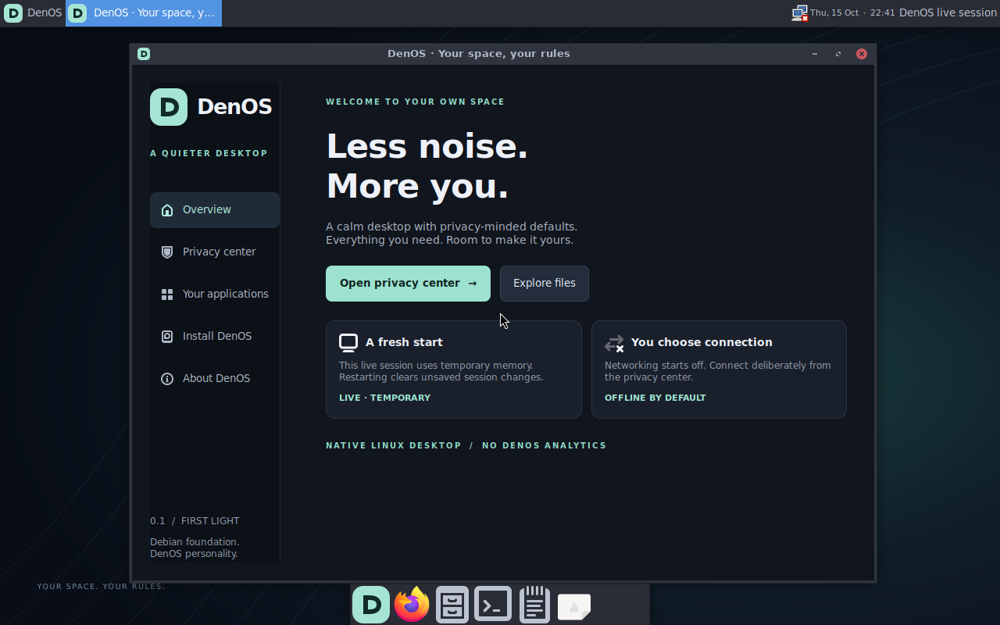

# DenOS

**Your space. Your rules.**

DenOS is a bootable Linux desktop built on **Debian 13 (trixie)**, with a dark Xfce interface and a native GTK Privacy Center. Version **0.1 — First Light** brings deliberate network access, familiar desktop applications, and privacy-minded defaults together in a small independent remix.

[Download the ISO](https://github.com/Dol0resH8ze/DenOS/releases/tag/v0.1.0) · [User guide](README.txt) · [Installer details](README-installer.md)



## What is included

- A real amd64 Linux system with Xfce 4.20, an Arc-Dark theme, custom wallpaper, and a dock.
- Native DenOS Privacy Center with working offline/online controls and firewall status.
- Firefox ESR, Thunar file manager, Mousepad text editor, and Xfce Terminal.
- BIOS and UEFI live boot, an optional whole-disk installer, and a Windows VirtualBox launcher.

## Privacy defaults

Networking starts disabled on every fresh boot, including installed-system boots. Offline mode blocks outbound traffic through nftables and disables NetworkManager. Enable access in **Privacy Center → Network access**, then use the panel network icon to choose a connection. Online mode allows outbound traffic while filtering unsolicited inbound traffic, with the documented ICMP, DHCP, loopback, and established-connection exceptions.

Firefox telemetry and studies are disabled by policy; strict tracking protection and always-private browsing are defaults. Shell history and GTK recent-file lists are disabled, and system logs use volatile storage. DenOS supplies no analytics service; included applications can make service and update requests after networking is enabled.

Live sessions use a temporary RAM overlay with persistence disabled. Files deliberately saved to mounted disks remain there. RAM is not securely scrubbed, and private browsing does not hide your IP address.

## Try DenOS

Download `DenOS-0.1-amd64.iso` and its checksum from [Releases](https://github.com/Dol0resH8ze/DenOS/releases/tag/v0.1.0). ISO images are release assets; this repository contains the build and customization source.

Use an Intel/AMD 64-bit VM with **4 GB RAM recommended**. Attach the ISO as its optical drive and disable Secure Boot. The live desktop signs in automatically:

| Live username | Live password |
| --- | --- |
| `den` | `denos` |

These are **public live credentials**. The live account has passwordless sudo and is intended for trying the system.

On Windows, place the ISO beside the files from [`windows-launcher/`](windows-launcher/) and double-click `Start-DenOS.cmd`. VirtualBox 7.1 or newer is required. The default VM boots live without creating a hard disk. Use `Start-DenOS.cmd -WithDisk` to opt into a sparse 24 GB virtual installation disk; see the [launcher guide](windows-launcher/WINDOWS-LAUNCHER.txt).

## Installation and release limits

**The installer erases the entire selected disk and creates an unencrypted ext4 installation.** It requires at least 20 GiB, shows the plan, and requires an exact erase phrase before writing. It supports one whole disk, with BIOS and EFI boot partitions. Dual boot and disk encryption are not provided.

Preview the installation plan without changing disks:

```sh
sudo denos-install --dry-run
```

Installed accounts receive a new password; live autologin and general passwordless sudo are removed. The three fixed Privacy Center commands remain available to the installed administrator without an extra password prompt.

This is an experimental first release without an independent security audit. It provides no VPN, Tor routing, anonymity, or secure-erase guarantee. Secure Boot is unsupported. Only Debian main drivers and firmware are included; physical hardware and proprietary Wi-Fi/GPU support have not been validated. Test in a VM first.

## Build from source

Run these commands as root on an amd64 Debian-compatible Linux build host, allowing about 8 GB of space plus downloaded packages:

```sh
bash base/install-build-tools.sh
bash base/bootstrap.sh
bash customize.sh
bash package-iso.sh /absolute/path/DenOS-0.1-amd64.iso
```

The build root defaults to `/tmp/denos-build`; override `DENOS_BUILD_ROOT` as needed. WSL builds should keep the root filesystem on WSL's Linux filesystem to preserve Unix ownership and symlinks. Builds use current trixie repositories, so package versions can change between rebuilds.

| Source | Purpose |
| --- | --- |
| [`base/`](base/) | Bootstrap scripts and package manifests |
| [`overlay/`](overlay/) | Native apps, installer, privacy policies, and desktop assets |
| [`configure-overlay.py`](configure-overlay.py) | Generate desktop configuration and browser policies |
| [`customize.sh`](customize.sh) / [`package-iso.sh`](package-iso.sh) | Apply customizations and package the bootable ISO |
| [`windows-launcher/`](windows-launcher/) | Optional VirtualBox launcher and instructions |

Updates use Debian's signed repositories. DenOS customizations have no separate automatic update service.

## Verification

QEMU testing covered live and installed BIOS/UEFI boot, all five native app pages, offline/online transitions, and an HTTPS connection. Two disposable 24 GiB disks completed installation and booted without the ISO. Package, syntax, sudoers, and installer static checks passed.

After final minor corrections, the exact release ISO received a final BIOS desktop smoke test. Physical hardware and USB writing were not tested. The Windows launcher received syntax and CLI-flag checks only; it was not executed during development.

## License and attribution

DenOS customizations are [MIT licensed](LICENSE). Included software retains its respective licenses; see [NOTICE.md](NOTICE.md). DenOS is an independent remix and is not an official release or endorsement by Debian, Linux, Xfce, or Mozilla.
